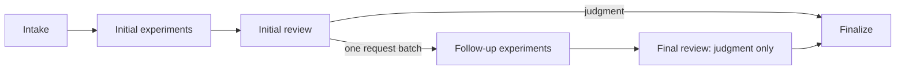

# Phase and trust contracts

## State machine

`pipeline.execute` only executes immutable candidate entrypoints or protected
registered checkers. Both use the same budgeted phase reports. `pipeline.review` only
calls the configured reviewer. `pipeline.finalize` validates the entire chain
and projects a judgment. Proof-only initial evidence is an empty successful
report. Direct initial judgments must not carry follow-up artifacts; requested
follow-up batches require both execution evidence and a final judgment. A second
request round is a protocol failure. With no requests, both follow-up jobs may be
skipped without skipping finalization.

Judgments contain exactly `valid`, `scores`, `reason`, `evidence_refs` and
`review_standard`. Validity accepts or rejects the entire original manifest claim
set as written; no second claims list or report can redefine it. Reason is
nonempty, bounded to 4,000 UTF-16 code units for Yukon. Valid judgments cite at
least one known source or run reference. References are `source:<relative-path>`
and `run:initial:<index>` / `run:followup:<index>`. The mandatory
[atomic scientific policy](atomic-claims.md) governs assumptions, scope and
external premises; semantic adequacy remains an LLM assessment.

The model's stage response is `{kind, judgment, requests}`. A judgment has
`kind: "judgment"`, the judgment object and `requests: []`; a request batch has
`kind: "followup"`, `judgment: null` and 1..budget request objects with exactly
`experiment`, `inputs`, `reason`, or `check`, `inputs`, `reason` for a registered
organizer checker. The selectors cannot be mixed. An empty batch is represented by a direct
judgment, never an ambiguous request without a next step.

## Snapshot and artifact binding

Intake reads each regular file through descriptor-relative `O_NOFOLLOW` paths,
including all parents, uses nonblocking opens before `fstat`, rejects special
files/FIFOs and hardlinks, and bounds counts/bytes. Traversal, symlinks, NULs,
BOMs, unsupported encodings, duplicate JSON keys, NaN/Infinity, overflowed floats
and excessive JSON structure fail. Python encoding cookies must agree with the
UTF-8 source the judge sees. Inputs are snapshotted once; subsequent source edits
do not affect executed bytes.

Artifacts have `version`, `stage`, `bindings`, `parents`, `simulation`, `data` and
`sha256`. SHA-256 uses sorted compact ASCII JSON with finite numbers. Bindings
cover the effective config (full rules, policies, provider and limits), complete
submission, random per-evaluation ID, execution context and installed verifier
source. Every phase verifies the embedded inputs, its exact predecessor digests,
and the current verifier's content hash. Duplicate JSON structures compare canonical
bytes, so integers, floats and booleans cannot substitute for one another. Model provenance binds exact prompt and
schema hashes, configured/returned model, request ID if present, numeric usage,
generation-attempt count, elapsed time and the selected fixed OpenAI endpoint. No routing metadata is
retained. `request_id` records the completion envelope ID when present, not an HTTP
header.

Local provenance records hashes of **all installed package `.py` files**, not
an unrelated/bootstrap Git SHA. Local revisions are unasserted. Hosted provenance
also records the verified challenge revision, verifier revision, root/submission/
score paths, workflow file hash and run ID/attempt. No moving-branch lookup occurs
at runtime. Changing source while a pipeline is in progress invalidates its
artifacts; restart intake under the new implementation.

These hashes provide integrity/binding, not authenticity. An attacker can
recompute hashes; never accept candidate-uploaded reports as organizer evidence.
The hosted workflow only downloads its own run's named organizer artifacts and
passes the separately produced intake digest to every consuming phase.

## Execution protocol

Stdin is exactly one canonical UTF-8 JSON object plus newline. Stdout must be
exactly one UTF-8 JSON object (whitespace allowed), with no logs or extra JSON;
use stderr for diagnostic text. Both streams have separate limits. Parsed result
values are retained alongside complete captured bytes (base64) and decoded text;
not merely hashes. Nonzero exits, invalid UTF-8/JSON, timeout and output overflow
are explicit failed-run evidence. Docker startup failures, signals killing the
host Docker CLI, unavailable image/daemon and unverified cleanup are infrastructure
failures. Reserved Docker codes 125–127 are conservatively infrastructure even if
an entrypoint deliberately returns one. Failure never implies mathematical
acceptance.

Each execution makes a fresh directory from snapshot bytes. A fixed
`/snapshot/entrypoint.py` is the exact selected entrypoint; original files are
read-only at `/snapshot/files/<path>`. Python runs with `-I -B`, workdir `/tmp`,
standard library only, and no automatic sibling imports. Programs can explicitly
read their submitted data under `/snapshot/files`. Organizer checks instead
receive only their explicit protected bundle at the same fixed layout, never
candidate files. The runner exposes only its fixed
Python entrypoint, with no configured shell/install command or dependency-install
stage. Submitted Python can invoke tools already present in the pinned image;
those processes remain subject to the same sandbox limits. No writable workspace,
host secret or Docker socket enters the container.
The runtime is official Python, pinned by digest on linux/amd64. Host Docker uses
an empty temporary config and a fixed local Unix socket. The container has no
network, nonroot UID/GID 65534, read-only root, dropped capabilities,
no-new-privileges, bounded tmpfs/memory/swap/CPUs/processes/file descriptors/file
size, no core dumps, and no Docker log storage. Stdout/stderr are drained
concurrently. Timeout/output overflow kills the host process and removes only
that generated container name; removal failure requires independent proof of
absence or fails infrastructure. There is no unsandboxed fallback.

## Provider boundaries

Only the review job has `OPENAI_API_KEY`. Rules, checker descriptors/schemas
and the derived score gate are in the system message;
full submission files and captured evidence are user-message data. Protected checker source bytes are retained in intake/dossier, not sent to the
model. No candidate source or captured evidence is hidden to fit context: the exact serialized full prompt must fit the
organizer cap or the review fails before a call. LLM prompt-injection resistance
is not a proof guarantee; the deterministic execution and output boundaries do
not depend on model obedience.

A killable Python worker handles HTTP. The credential and request use a private
stdin pipe, not argv, inherited worker environment, disk or logs. A parent deadline
covers DNS, TLS, request writing, trickled headers and body reads. Responses and
attempts are bounded; the worker is reaped on timeout. Redirects are never followed.
Only transport failures, HTTP 429 and 5xx get bounded retries. Malformed, refused,
truncated, tool-call, multi-choice, error-bearing or semantically invalid responses
fail without repair; valid rejections are never retried. HTTP error bodies,
exception text, arbitrary usage metadata, headers and raw provider errors are not
published. OpenAI configuration and native schema compatibility are explicit,
with no model/provider fallback. Explicit background mode accepts only a completed
Responses object with one assistant text message and normalizes it into the same
envelope. It uses bounded polling of one response ID, best-effort cleanup and
store=false; see configuration for temporary polling-state retention and exact
HTTP/generation bounds. Otherwise, only a non-streaming `chat.completion` envelope
with one assistant text choice, `finish_reason: "stop"`, and no non-null refusal
is eligible for local judgment validation. Requests explicitly send `store: false`;
see [configuration and retention controls](configuration.md#provider-configuration).

## Yukon projection

For both fields: valid scored → `{valid:true,scores:[...],reason:...}`; valid
unscored → `{valid:true,scores:null,reason:...}`; invalid →
`{valid:false,scores:null|[...],reason:...}`. Invalid measured tuples are retained
when both fields are requested, but only if all configured required checks pass
for the submission-declared canonical inputs. This gate applies even when scores
are hidden by field projection. See [checker bindings and gate](checkers.md). Validity-only emits `valid` and `reason`.
Scores-only emits just `scores` and still requires a legitimate valid claim;
otherwise it fails, preserving previous platform evidence. Null is explicit.
Dossier/provenance is uploaded separately and does not add fields to the Yukon
artifact. One logical evaluation is produced despite multiple model/execution
phases. Infrastructure failures leave no stale final score at the requested path.
